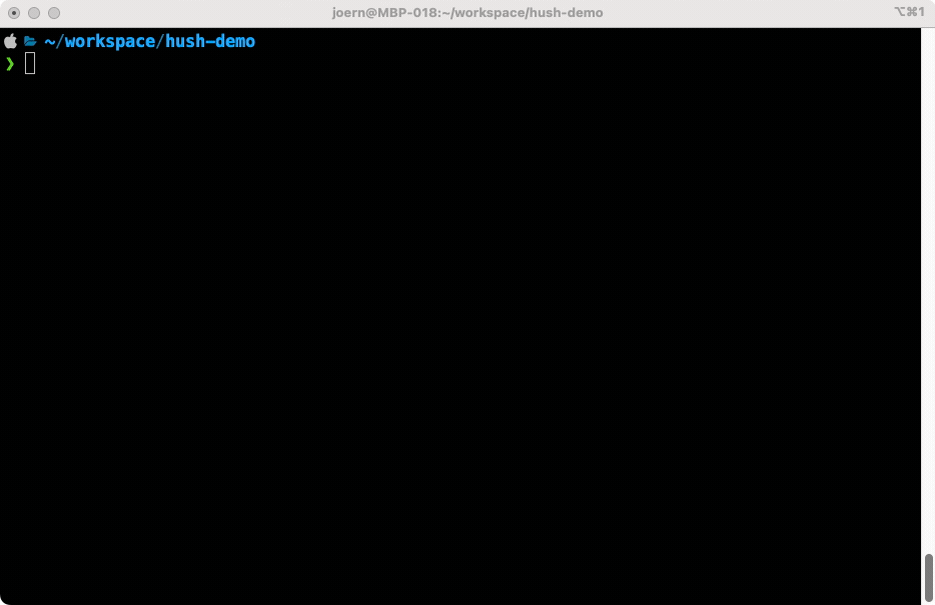

# `hush list`

This command lists **all Hush! secrets that the current AWS profile has access to**.

If your project has a [project setting](/backends/project-setting) with **several backends**, `list` shows **one table per backend**. Each table starts with a title row that names the backend and where it keeps its secrets, for example `Backend: ireland (AWS eu-west-1)`. A backend that can't be listed shows the reason instead of a table; the other backends are still listed.

It displays the following fields for each secret:

- Name
- Last push message
- Updated at
- Secrets count

!!!
Please note that the Name has the "hush-" prefix attached to it.
!!!
